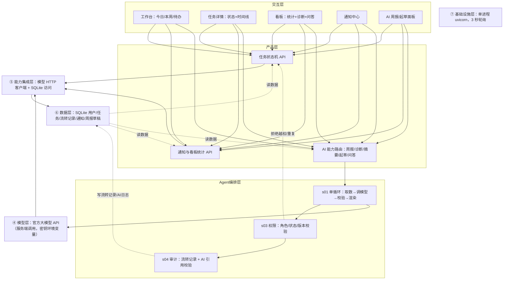

# BranchRelay 架构方案（V2）

> 执行方式：**当前 Codex 按项目手册（BLUEPRINT.md / 使用引导.md / 组件说明）分析，未运行独立模型管线**。选型由「当前 AI 特征判断 + 原引擎固定规则（`local_tools.py select`）」得出；`plan.json`、stages、token 用量与独立模型审稿均不存在。V2 在 V1 基础上把 AI 从「单周报」升级为「AI 能力矩阵」。

## 0. 待确认与默认假设

| # | 事项 | 默认假设（可逆） |
|---|---|---|
| Q1 | 官方模型 API 地址、模型名、鉴权 | 已确认：`https://api.openai-next.com/v1` + `gpt-6.2-astra` + Bearer（OpenAI 兼容） |
| Q2 | 模型密钥是否可用 | 已确认：可用；密钥仅存 `skeleton/.env`；不可用时所有 AI 能力走「规则汇总/空态」降级 |
| Q3 | 技术栈 | 已确认：Python 3.12 + FastAPI + SQLite（stdlib），前端原生 HTML/JS |
| Q4 | 实时同步方式 | 默认 3 秒轮询，不引 WebSocket/SSE |
| Q5 | 评委复现的启动/运行方式 | 默认一条命令起服务 + 一键重置数据 + README |
| Q6 | AI 能力矩阵演示优先级 | 默认核心演示周报 + 诊断 + 问答；摘要与起草作辅助入口，时间紧可先砍起草 |

## 1. 需求摘要

BranchRelay 是上海银行北京中关村支行「智能办公与协同管理平台」的比赛 Demo：让一项工作从安排、办理到复核始终有明确接手人，任务信息实时同步、全程可追踪、流程自动衔接。**主体是传统 Web 状态机**（任务 CRUD + 角色权限 + 通知看板），**AI 层以「能力矩阵」嵌入五个环节**：周报生成、进度诊断、任务摘要、智能起草、自然语言问答。所有 AI 输出只归纳事实、引用任务编号、角色范围由服务端校验、不可用时降级。

## 2. 五要素清单

| 要素 | 映射 |
|---|---|
| 工具 Tools | 读任务/流转记录与统计、通用模型调用（统一超时/重试）、引用校验、草稿/结论保存、起草助手 |
| 知识 Knowledge | 周报归纳规则、诊断规则、状态机规则、演示数据口径（本版无 RAG，规则写在代码与提示词） |
| 观察 Observation | 流转记录（事件日志）、看板统计、通知去重键、版本号、AI 调用日志与数据截止时间 |
| 行动 Action | Web 表单/按钮触发服务端 API 写入；AI 能力由服务端调模型后回填草稿/结论 |
| 权限 Permissions | 服务端角色范围校验、写入前校验当前处理人+状态+版本、AI 查询范围二次校验、拒绝越权与重复 |

## 3. 组件选型（17 项，V2）与理由

| 组件 | 决策 | 理由 |
|---|---|---|
| s01 Agent Loop | **必选** | 每个 AI 能力都是一个最小闭环：取数→调模型→校验→渲染/降级（恒选） |
| s02 工具系统 | **必选** | 需要调用官方模型 API、读 SQLite、保存草稿（恒选） |
| s03 权限系统 | **必选** | 角色范围校验、当前处理人/状态/版本校验、A05/A14 拒绝越权与重复 |
| s04 钩子系统 | **必选** | 每次操作写流转记录；所有 AI 输出渲染前校验引用编号与分组 |
| s06 子 Agent | **二期** | 任务量增大时逐任务摘要/诊断可并行并隔离上下文；MVP 6 任务单次调用即可 |
| s15 集成 Harness | **二期** | 一期可选组件仅 s03/s04；二期 s03+s04+s06 达到 3 个时归一为单一循环 |
| s05/s07–s14/s16/s17 | 放弃 | 无多步 Agent 规划、明确无 RAG/后台定时/多 Agent 团队/MCP/固定无决策编排/独立评估器 |

结论：**一期骨架 = 单循环（s01）+ 5 个 AI 工具与领域操作（s02）+ 权限（s03）+ 审计/输出校验（s04）**，落在单进程 FastAPI 里与任务状态机共用 SQLite。**二期**在任务量增长时引入 s06 并行摘要，再视需要以 s15 归一集成——不是一期的必需项。

## 4. AI 能力矩阵

统一原则：**程序算数与状态，模型只组织语言**。每个能力都走同一模型调用入口（超时/重试/降级）与同一引用校验器（s04）。

| 能力 | 触发入口 | 输入（程序提供） | 输出 | 模型职责 | 程序职责 | 降级 | 验收 |
|---|---|---|---|---|---|---|---|
| ① 周报生成 | 工作台「AI 周报」 | 所选角色可见任务：编号/标题/节点/处理人/期限/本期文字记录 | completed/pending/next_week 三组 + 引用 | 归纳文字 | 统计数量、分组、状态标签、渲染回跳 | 规则汇总（带标签） | A06/A08/A09/A10 |
| ② 进度诊断 | 看板「一键诊断」 | 全支行本周任务事实 | risks[]：受影响任务/类型/状态/建议跟进人/一句建议 | 归纳风险表述 | 计算逾期、待复核积压、待补充滞留等硬事实 | 规则汇总 | A11 |
| ③ 任务摘要 | 列表/详情自动 | 单任务流转记录 | 一句话进展摘要 | 归纳记录 | 决定何时重新生成、随最新事件失效 | 空态（无记录） | A12 |
| ④ 智能起草 | 表单「AI 起草」按钮 | 岗位 + 上下文（任务标题/说明 或 退回场景） | 草稿文本 | 润色/补全 | 只回填到可编辑输入框，不自动落库 | 隐藏按钮或提示手写 | A13 |
| ⑤ 自然语言问答 | 看板「问进度」 | 用户问题 + 角色可见任务事实 | answer + refs[] | 组织回答 | 解析意图、查询过滤、渲染引用、范围校验 | 返回「未查询到/范围外」 | A14 |

## 5. 七层架构与数据流



- **① 交互层**：原生 HTML/JS 单页，右上角模拟身份切换，每个标签页保留各自身份；五个入口覆盖任务 + 五项 AI 能力。
- **② 产品层**：FastAPI 提供任务状态机、通知、看板统计、AI 能力五条路由；AI 路由统一走同一模型客户端与校验器。
- **③ Agent 编排层**：周报/诊断/摘要/起草/问答共用一个单循环；s03 在入口做角色/范围/状态/版本校验，s04 在写前记录流转、在模型输出后校验引用。
- **④ 模型层**：官方大模型，仅组织语言；数量与状态由程序计算；密钥环境变量，不入库不入镜。
- **⑤ 能力集成层**：模型 HTTP 客户端（超时/重试/降级）+ SQLite 访问；无 MCP/第三方。
- **⑥ 数据层**：SQLite 五张表（用户/任务/流转记录/通知/周报草稿），周报草稿与 AI 结论记录数据截止时间。
- **⑦ 基础设施层**：单进程本地服务，3 秒轮询刷新；无需后台定时服务。

## 6. 工具清单（名称 / 输入 / 输出 / 副作用 / 权限）

**AI 工具（s01/s02 loop 内）**

| 工具 | 输入 | 输出 | 副作用 | 权限 |
|---|---|---|---|---|
| `collect_facts(role, week, kind)` 取数 | 角色、周、能力类型 | 角色可见任务事实（编号/标题/节点/处理人/期限/记录） | 无（只读） | 角色范围；支行范围仅负责人 |
| `call_model(capability, facts)` 调模型 | 能力类型 + 事实 + 提示词 | 对应 JSON（report/diagnosis/summary/draft/answer） | 外部 API 调用 | 仅服务端 |
| `validate_refs(model_json, facts, capability)` 校验 | 模型输出 + 本次输入 | 通过 / 错误项 | 无 | 服务端 |
| `save_report_draft(...)` 保存周报草稿 | 角色、范围、周、内容、引用、截止时间 | 草稿记录 | 写 SQLite | 角色范围 |
| `draft_assist(kind, context)` 起草 | 岗位 + 上下文 | 草稿文本 | 无（只回填输入框） | 角色范围 |

**领域操作（s03 权限 + s04 审计约束下）**

| 操作 | 输入 | 输出 | 副作用 | 权限 |
|---|---|---|---|---|
| `create_task` / `start_task` / `update_progress` / `submit_review` / `reject` / `approve` | 表单/按钮参数 | 新状态、处理人、事件、通知 | 写 SQLite（事务） | 当前处理人+状态+版本校验 |
| `reset_demo_data()` | 无 | 固定演示快照 | 重建 SQLite | 仅本地演示命令 |

## 7. 系统提示词草案

**① 周报**
```
你是支行周报归纳助手。根据给定任务事实生成周报草稿。
规则：
1. 只依据输入中的任务编号、标题、节点、处理人、期限与文字记录归纳。
2. completed 只收录本期复核通过的任务；pending 列出本周相关且截止时未完成的任务，按逾期、待补充、待复核优先；next_week 来自已登记的下周计划日或截止日。
3. 每条 text 必须引用已有任务编号；不推测延误原因、完成比例或客户成效。
4. 无对应内容时该组返回空数组。
只输出 JSON：{"completed":[{"task_id":"T-001","text":"..."}],"pending":[],"next_week":[]}
```

**② 进度诊断**
```
你是支行工作进度诊断助手。根据给定任务事实，识别风险与阻塞点。
规则：只依据输入事实，引用任务编号；识别逾期未完成、待复核积压、待补充滞留、截止临近；每条风险给出受影响任务编号、当前状态、建议跟进人、一句建议；不推测延误原因、不评价个人、不虚构。
只输出 JSON：{"risks":[{"task_id":"T-004","type":"overdue","status":"待补充","owner":"零售岗","advice":"..."}]}
```

**③ 任务摘要**
```
你是任务进展摘要助手。根据任务流转记录，给出一句话进展摘要。
规则：只依据记录、引用事实、不含推测；无记录时 summary 为空字符串。
只输出 JSON：{"summary":"..."}
```

**④ 智能起草**
```
你是支行办公助手。根据给定岗位与上下文，起草或润色一段文字。
- 综合岗任务说明：简洁说明目标、交付物、时间要求。
- 复核人退回意见：指出需补充的具体点，语气专业客气。
用户可编辑后再提交，你不直接落库。
只输出 JSON：{"text":"..."}
```

**⑤ 自然语言问答**
```
你是支行进度问答助手。根据给定任务事实与用户问题，归纳回答。
规则：只依据输入事实，引用任务编号；数量与状态由程序提供，你只组织语言；无相关事实时回答「未查询到」。
只输出 JSON：{"answer":"...","refs":["T-004"]}
```

## 8. 失败处理

| 场景 | 降级 |
|---|---|
| 模型超时/密钥缺失/返回格式异常/引用未知编号 | 保留原草稿/结论，提供「重试」与「按规则汇总」（标注来源） |
| 双窗口重复/过期操作 | 版本号不匹配 → 拒绝写入，提示「任务已更新」并重载 |
| 越权（经办人复核、范围外查询、零售岗查支行范围） | 服务端拒绝，不产生事件 |
| AI 起草 | 只回填可编辑输入框，失败隐藏按钮提示手写，不落库 |
| 读取失败 | 前端保留旧内容与更新时间，重试入口，恢复后自动重试 |
| 空范围（空周/无任务） | 不调用模型，直接空态 |

## 9. 验收（对齐 PRD 第 7 节 + AI 矩阵）

A01–A10 全过（任务安排、跨岗交接 5 秒同步、退回再提交、日期通知去重、越权重复拒绝、周报准确性、持久化、API 失败、范围历史、历史截止）；A11 诊断与统计一致且引用可回跳；A12 摘要随提交更新；A13 起草可编辑不落库；A14 问答返回 T-004 且零售岗无法查支行范围。AI 实测记录与人工验收分开记录在迭代记录中。

## 10. 实施顺序（V2 细化）

| 顺序 | 开发内容 | 完成判断 |
|---|---|---|
| 1 | 初始化 4 角色 + 6 任务 + 合法历史 + 重置命令；试通官方 API | 可稳定重置快照，知道模型能否调用 |
| 2 | 任务状态机：创建/开始/更新/提交/退回/通过 + 流转记录 + 版本校验 | 同一条任务走通，刷新保留 |
| 3 | 工作台、通知、看板 + 3 秒轮询 | 双窗口真实更新 |
| 4 | AI 能力矩阵：周报/诊断/摘要/起草/问答 + 统一模型客户端 + 引用校验 + 降级 | 通过 A06–A14，每条结论可回跳 |
| 5 | 录屏、导出、复查运行方式 | 11-22 11:00 前完成视频导出并复查 |
